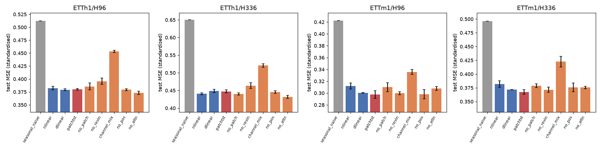

# Do small transformers beat linear models for time-series forecasting? A controlled ablation on ETT

Vaibhav Lalwani. All numbers below come from the runs stored in `results/` (200 result files, 5 seeds per trained model).

## 1. Question and hypotheses

Zeng et al. (2023) showed that one linear layer can match or beat many transformer forecasters. Later patch-based transformers (PatchTST, Nie et al., 2023) reported good numbers again. I wanted to know, on my own hardware and with a controlled setup, which parts of a small patch transformer matter.

- **H1.** A small patch transformer beats the linear baselines (NLinear, DLinear) on long-horizon forecasting.
- **H2.** Each design choice (patching, reversible instance norm, channel independence, positional embedding, attention layers) helps.

I pre-decided that I would report the result even if the hypotheses failed. **They mostly failed** (section 4).

## 2. Method

**Data.** ETTh1 (hourly) and ETTm1 (15-minute) electricity-transformer data, 7 channels. Standard chronological 12/4/4-month train/val/test split used by Informer, Autoformer, DLinear and PatchTST. The scaler is fit on the training months only. The test set (the last 4 months, Oct 2017 to Feb 2018) is never used for any choice. Test windows: ETTh1 2785 (H=96) and 2545 (H=336); ETTm1 11425 and 11185. Data is downloaded at run time (it is CC BY-ND 4.0, so it is not redistributed here).

**Task.** Multivariate forecasting: look-back L=336, horizons H=96 and H=336, all 7 channels, MSE on standardised values.

**Models** (`models.py`).
- Baselines: `naive` (repeat last value), `seasonal_naive` (repeat last day), `nlinear`, `dlinear`.
- `patchtst`: patch length 16, stride 8, d_model 64, 4 heads, 2 pre-LN encoder layers, d_ff 128, dropout 0.2, RevIN, learned positions, channel-independent, flatten head. 329k parameters.
- Ablations, each changing exactly one switch from `patchtst` (checked by a unit test): `no_patch` (patch length 1), `no_revin`, `channel_mix` (all channels in one token), `no_pos`, `no_attn` (0 encoder layers: patch embedding plus linear head).

**Training and tuning.** AdamW, bf16 autocast, batch 128, early stopping on validation MSE (patience 4). The learning rate is chosen per (dataset, model) from {1e-4, 3e-4, 1e-3} using seed 0 at H=96 by **validation** MSE only; the same lr is then used for H=336. Final results: 5 seeds (0 to 4) per model, mean ± sample std.

**Significance.** Diebold-Mariano test (Harvey small-sample correction, Newey-West window H-1) on per-window test MSE, averaged over seeds, full `patchtst` versus each other model. Windows overlap, so the HAC variance matters. P-values are **not** corrected for the many comparisons I ran, so read them as a guide.

## 3. Results

Test MSE, mean ± std over 5 seeds (best per column in bold; the baselines `naive` and `seasonal_naive` are deterministic). Full MAE table in `results/tables.md`.

| model | ETTh1 H96 | ETTh1 H336 | ETTm1 H96 | ETTm1 H336 |
|---|---|---|---|---|
| naive | 1.2944 | 1.3299 | 1.2139 | 1.2866 |
| seasonal_naive | 0.5122 | 0.6499 | 0.4227 | 0.4961 |
| nlinear | 0.3824 ± 0.0036 | 0.4408 ± 0.0027 | 0.3119 ± 0.0053 | 0.3818 ± 0.0060 |
| dlinear | 0.3792 ± 0.0018 | 0.4490 ± 0.0047 | 0.3006 ± 0.0004 | 0.3717 ± 0.0003 |
| **patchtst (full)** | 0.3800 ± 0.0015 | 0.4475 ± 0.0042 | **0.2976 ± 0.0063** | **0.3675 ± 0.0042** |
| no_patch | 0.3856 ± 0.0065 | 0.4404 ± 0.0031 | 0.3100 ± 0.0076 | 0.3787 ± 0.0034 |
| no_revin | 0.3957 ± 0.0059 | 0.4637 ± 0.0080 | 0.2998 ± 0.0025 | 0.3715 ± 0.0047 |
| channel_mix | 0.4533 ± 0.0020 | 0.5207 ± 0.0048 | 0.3356 ± 0.0041 | 0.4227 ± 0.0098 |
| no_pos | 0.3795 ± 0.0019 | 0.4457 ± 0.0041 | 0.2980 ± 0.0079 | 0.3757 ± 0.0079 |
| no_attn | **0.3733 ± 0.0031** | **0.4319 ± 0.0041** | 0.3078 ± 0.0034 | 0.3756 ± 0.0023 |



Change in test MSE versus the full `patchtst` (positive = the variant is worse), with the DM p-value:

| variant | ETTh1 H96 | ETTh1 H336 | ETTm1 H96 | ETTm1 H336 |
|---|---|---|---|---|
| nlinear | +0.6% (p=0.62) | -1.5% (p=0.35) | +4.8% (p=0.029) | +3.9% (p=0.12) |
| dlinear | -0.2% (p=0.90) | +0.3% (p=0.93) | +1.0% (p=0.64) | +1.1% (p=0.63) |
| no_patch | +1.5% (p=0.007) | -1.6% (p=0.003) | +4.2% (p=0.017) | +3.0% (p=0.064) |
| no_revin | +4.1% (p=0.058) | +3.6% (p=0.31) | +0.7% (p=0.56) | +1.1% (p=0.44) |
| channel_mix | +19.3% (p<1e-7) | +16.4% (p<1e-5) | +12.8% (p<1e-4) | +15.0% (p<1e-4) |
| no_pos | -0.1% (p=0.13) | -0.4% (p=0.009) | +0.1% (p=0.88) | +2.2% (p=0.016) |
| no_attn | -1.8% (p=0.11) | -3.5% (p=0.010) | +3.4% (p=0.12) | +2.2% (p=0.39) |

Cost (mean train seconds, ETTh1 H96 / ETTm1 H336) and size: `patchtst` 329k params, 19 s / 43 s; `no_patch` 2.16M params, 252 s / 1116 s; `no_attn` 262k params, 3 s / 8 s; `dlinear` 65k params, 2 s / 7 s; `nlinear` 32k params, 3 s / 6 s.

## 4. What the results say

1. **H1 is not supported.** The full transformer is within about 1% of DLinear in all four settings (DM p between 0.63 and 0.93), and NLinear is statistically tied with it on 3 of 4 settings. On ETTm1 the transformer has the best mean MSE, but its margin over DLinear (1.0% and 1.1%) is smaller than seed noise would let me call a win. A 2 to 8 second linear model is a strong baseline.
2. **Channel independence is the one choice that clearly matters.** Mixing channels into one token costs +13% to +19% MSE with p < 1e-4 in every setting, and it uses 5.7x more parameters.
3. **Attention layers did not help.** `no_attn` (patch embedding plus a linear head, no attention) is the best model on ETTh1 and is within 2 to 3.5% on ETTm1. The ETTh1 H336 gap (-3.5%, p=0.010) goes in favour of removing attention. This suggests that on these datasets the gains of "patch transformers" come mostly from patching, instance normalisation and channel independence, not from attention. I did not test other datasets, so I do not claim this generally.
4. **Patching helps on the 15-minute data, not clearly on hourly.** Without patching MSE is +4.2% and +3.0% worse on ETTm1 at 13 to 26 times the training time (measured on ETTh1 H96 and ETTm1 H336), but on ETTh1 H336 it is slightly better (-1.6%).
5. **RevIN and positional embeddings are small effects.** RevIN is worth about 4% on ETTh1 (p=0.058 at H96, not significant at H336) and nothing on ETTm1. Positional embeddings are within noise in 3 of 4 settings and +2.2% on ETTm1 H336.
6. **Variants are not consistently ranked across datasets.** The best model on ETTh1 (`no_attn`) is not the best on ETTm1 (`patchtst`). With 5 seeds and uncorrected p-values, I would only trust the large effects (channel independence, trained models versus naive baselines).

## 5. Error analysis

(`results/error_analysis.json`, full `patchtst`, seed-averaged per-window MSE.)

- **Errors are concentrated.** The worst 10% of test windows carry 17.5% to 25.8% of the total squared error. The single worst window is the same day for both datasets, around 2018-01-08, with MSE about 1.31 (ETTh1 H96 and ETTm1 H96): I did not investigate the cause.
- **Errors grow with the horizon.** For H=96 on ETTh1, MSE at step 1 is 0.145 and at step 96 is 0.421; on ETTm1 0.061 to 0.326.
- **Errors drift over time.** On ETTh1 H96 the monthly MSE goes from 0.253 (Nov 2017) to 0.477 (Jan 2018) and 0.495 (Feb 2018). Training covers Jul 2016 to Jun 2017 and the test period looks harder (possibly distribution shift; I did not test the cause). I have not tested whether re-fitting or online updating would help.
- **Channels differ a lot.** On ETTh1 H96 the hardest channels are MUFL (0.814) and HUFL (0.790); the easiest is OT, the oil temperature (0.055).
- **Transformer and DLinear fail in the same places.** The per-window error correlation is 0.92 to 0.98, and the transformer wins on only 45% to 68% of windows. So their differences are small relative to the shared difficulty.
- Plots: `results/plots/error_by_step.png`, `results/plots/error_over_time.png`.

## 6. Limitations

- Only two datasets from one source (both come from the same electricity transformer), 7 channels, and one look-back (336). Results may not transfer to other data.
- 5 seeds. The std is a sample std with 4 degrees of freedom, so it is itself noisy.
- The learning rate was tuned from only 3 values, on one seed and one horizon, and the other hyperparameters (d_model, depth, dropout, patch size) were fixed, not tuned. Small-model results could change with more tuning, for any of the models.
- DM tests use seed-averaged window losses (so they test the ensemble-mean behaviour, not a single seed), and I ran many tests without multiple-comparison correction.
- ETT is known to be a small dataset with strong shift between train and test; some of the literature's large reported gaps are within noise here.
- My numbers are not directly comparable to published tables unless the setup matches: I use my own training loop, bf16, early stopping on validation MSE.
- All training ran on a single shared laptop GPU (RTX 3050 6 GB).

## 7. Reproduce

```
pip install -r requirements.txt   # plus torch for your CUDA
python prepare_data.py            # downloads ETTh1/ETTm1, writes data/summary.json (sha256)
python run_all.py                 # about 5 hours on an RTX 3050; resumable
python analyze.py                 # tables, DM tests, error analysis, plots
pytest -q                         # 24 tests
```

## References

- Zeng et al., "Are Transformers Effective for Time Series Forecasting?" (AAAI 2023): NLinear, DLinear.
- Nie et al., "A Time Series is Worth 64 Words" (ICLR 2023): PatchTST.
- Kim et al., "Reversible Instance Normalization" (ICLR 2022): RevIN.
- Diebold and Mariano (1995); Harvey, Leybourne and Newbold (1997).
- Zhou et al., "Informer" (AAAI 2021): the ETT dataset.
